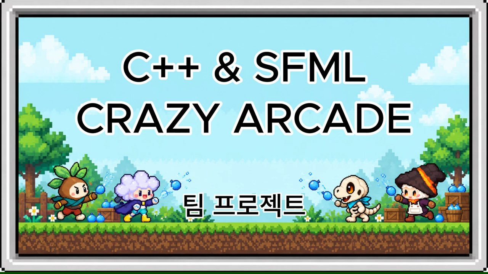
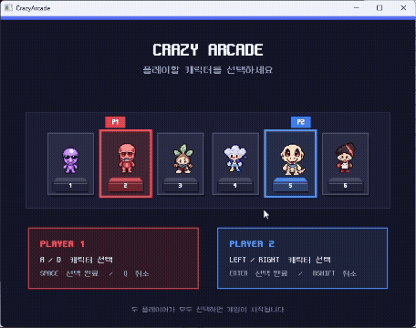
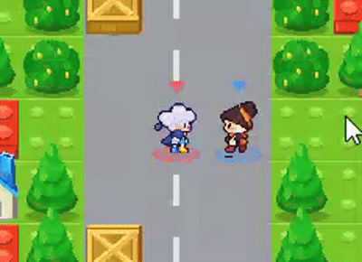

# 💧 CrazyArcade-SFML

**C++ / SFML로 만든 2인용 물풍선 대전 게임**

## 🎮 플레이
| 캐릭터 선택 | 게임 플레이 | 결과 |
|:---:|:---:|:---:|
|  |  |  |

- 1P / 2P가 한 키보드로 동시에 플레이
- 물풍선을 설치해 블록을 부수고 상대를 가두면 승리
- 아이템: 물풍선 개수 ↑, 물줄기 길이 ↑, 속도 ↑, 바늘(탈출)

## 👥 팀 구성 및 역할 분담
| 파트 | 내용 | 주요 파일 |
|---|---|---|
| A | 맵 · 블록 | `TileMap`, `TileArt` |
| **B ⭐** | **플레이어 (조민경 · 부팀장)** | **`Player`** |
| C | 물풍선 · 폭발 | `WaterBalloon` |
| D | 아이템 · UI | `Item`, `UI` |
| E | 게임 진행 · 화면 전환 | `Game` |

## 🙋‍♀️ 내 역할 — 플레이어 파트
- 1P / 2P **키 입력 분리** 및 동시 조작 처리
- **타일 기반 이동**과 블록 충돌 처리
- **방향별 걷기 애니메이션**, 캐릭터 스프라이트 출력
- SFML 수동 설치·프로젝트 설정 정리

## ▶️ 실행 방법
1. SFML 3.1을 `C:\SFML-3.1.0`에 설치 (경로가 다르면 프로젝트 속성의 include/lib 경로 수정)
2. `CrazyArcade.sln` 열고 **x64 / Debug**로 빌드
3. `C:\SFML-3.1.0\bin`의 `sfml-*-d-3.dll`을 실행 파일 폴더에 복사 후 실행
